# h5ai

[![Pipeline][pipeline-img]][pipelines]
[![Coverage][coverage-img]][pipelines]
[![Latest release][release-img]][releases]
[![License][license-img]][license]
[![Docker pulls][docker-pulls-img]][dockerhub]
[![Docker stars][docker-stars-img]][dockerhub]
[![Docker image size][docker-size-img]][dockerhub-tags]
[![W3C HTML][w3c-html-img]][w3c-check]
[![W3C CSS][w3c-css-img]][w3c-check]

A file index for Apache httpd, lighttpd, nginx and Angie.

h5ai replaces the default directory listing of a web server with a browsable
interface: folder tree, search, thumbnails, in-browser previews and archive
downloads. It reads the folders as they are, without a database or an import
step.

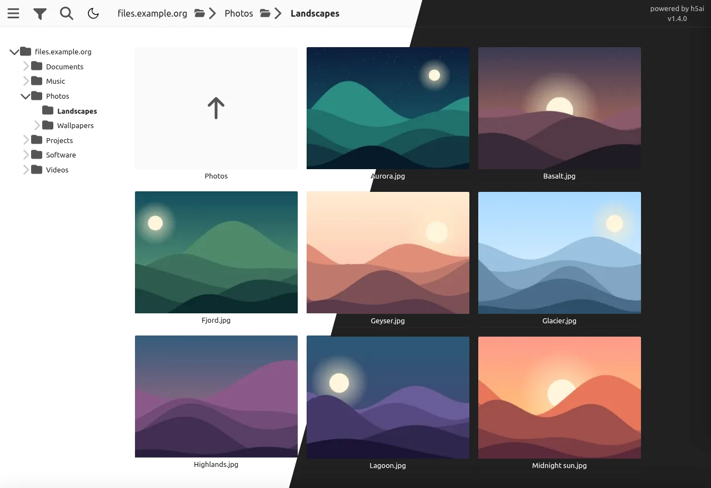

Typical uses are sharing a NAS on a local network, publishing release files,
or browsing a media library from a phone.


## Quick start

```bash
docker run -d -p 8080:80 -v /path/to/files:/share:ro pad92/docker-h5ai
```

Then open <http://localhost:8080/>. The image is built for `linux/amd64` and
`linux/arm64`.


## Features

### Browse

A folder tree, breadcrumbs, and three layouts (details, grid, icons) with
adjustable icon size. Folders show their total size, computed in the background
so listings stay fast. The view refreshes on its own when files change. Light
and dark themes follow the system setting, with a toggle in the toolbar.

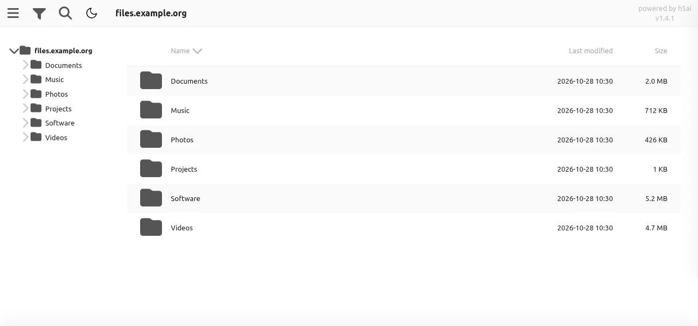

### Previews

A click opens the file in an overlay; the arrow keys move to the next one.

| | |
| --- | --- |
| 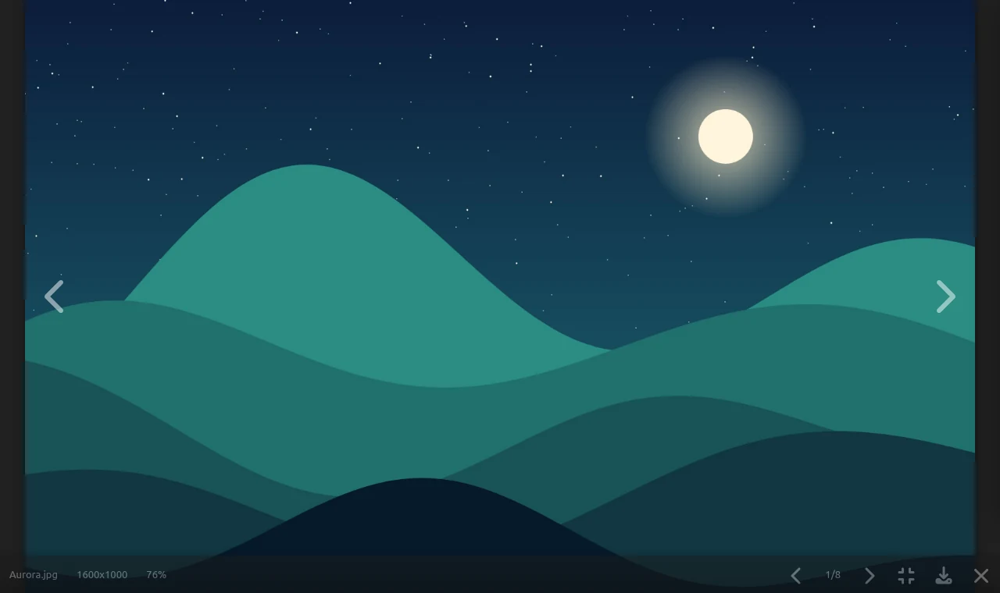 | 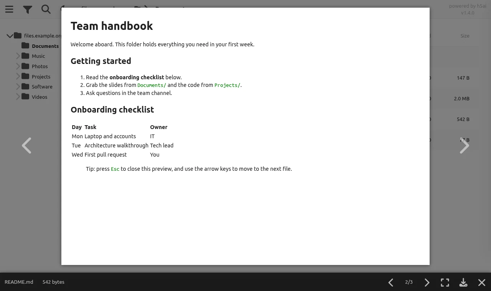 |
| **Images**: JPEG, PNG, WebP, AVIF, GIF, SVG, TIFF, BMP, plus HEIC, JPEG XL and camera RAW through a server-made copy, with EXIF details for photos. | **Markdown** rendered, plus plain text, CSV and logs. |
| 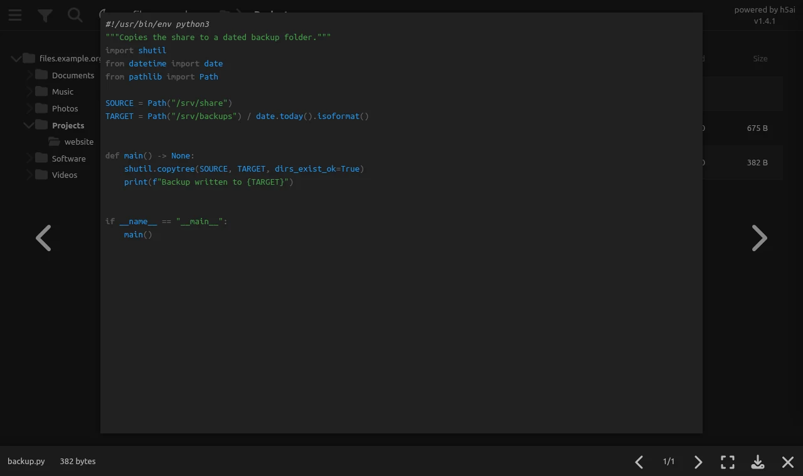 | 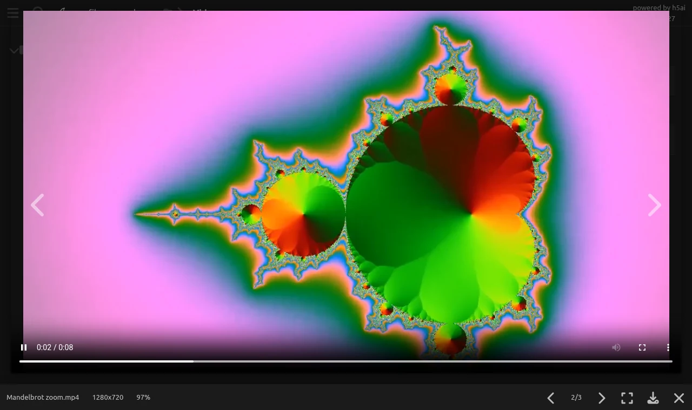 |
| **Source code** highlighted: Python, JavaScript, TypeScript, Go, Rust, C/C++, SQL and more. | **Video**: MP4, WebM, MKV, MOV and MPEG, in a built-in player. |

Audio plays in a player docked at the bottom of the page, with cover art, a
queue, shuffle and repeat; videos can join the same queue. Playback continues
while you browse other folders, the queue comes back on your next visit, and
it exports as an `.m3u8` playlist for VLC or MPC-HC
([how to](doc/configuration.md#playing-the-queue-in-an-external-player)).

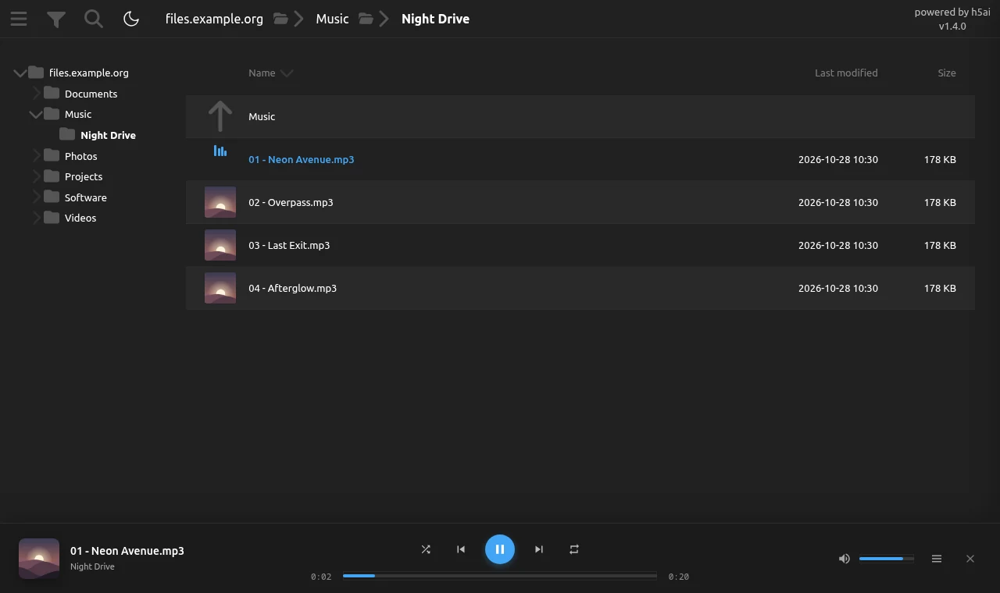

A click on the bar's cover opens the track in large: its cover over a
blurred copy of it, the title, artist, album and year read from the file's
tags (MP3 and FLAC), and the format, duration, bit rate and size. A click
on the large cover shows a visualizer in its place, and another click brings
the cover back. The menu below the cover picks the visualizer: Winamp's
spectrum analyser in its normal, fire or line style or with thin bands, its
oscilloscope as lines, dots or solid, a spectrogram, VU meters, a stereo
vectorscope, or a plasma, a kaleidoscope and a vortex that turn with the
music.

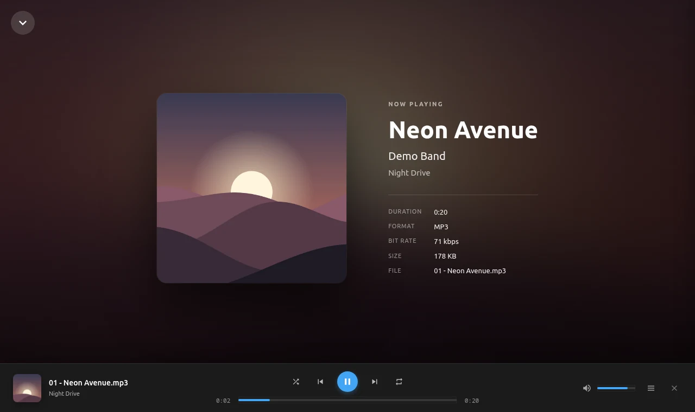

Thumbnails are generated for images, video frames, audio covers, PDF
documents, PostScript documents on hosts with Ghostscript, and ZIP or RAR
archives (comic books, for example), then cached.

### Search and download

One field filters the listing as you type and, on Enter or when nothing
matches there, searches all the subfolders too. Drag a rectangle or Ctrl-click to select files, then download them
together as a ZIP or TAR archive.

| | |
| --- | --- |
| 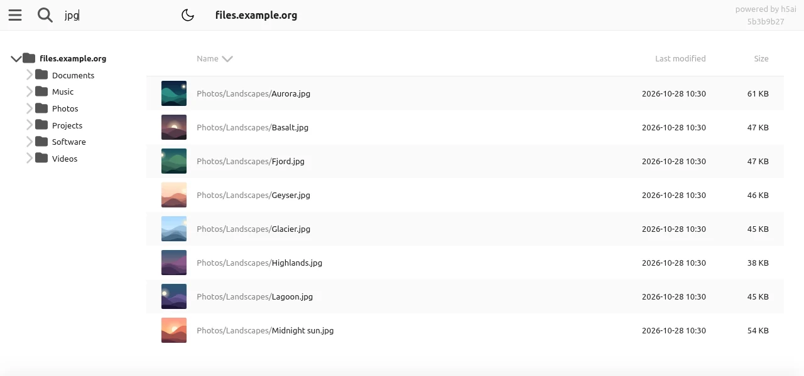 | 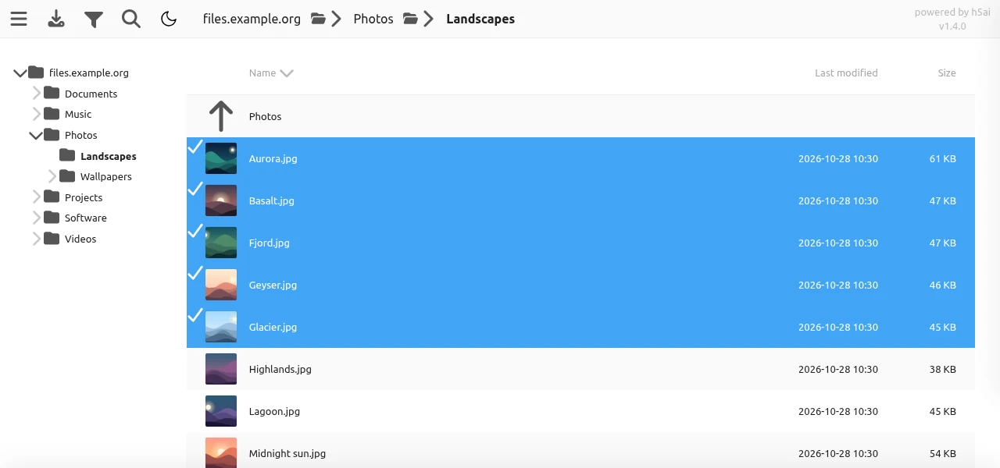 |

The optional info panel in the sidebar shows the details of the file under the
mouse, with a QR code of its link for opening it on a phone.

### Administration

The admin page checks the PHP setup and every helper tool, shows the cache and
the background tasks (cache warmer, folder sizes, thumbnails), and lets you
start, stop or purge them. Once its password is set, a link at the bottom of
the sidebar opens it.

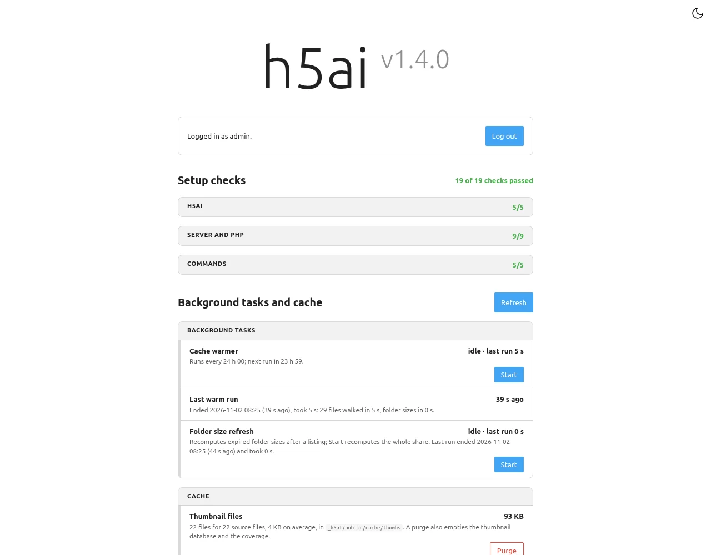

### Other features

* 35 interface languages.
* Custom header and footer per folder, in HTML or Markdown.
* Hidden-file rules, sort order, date format and almost everything else set in
  one [`options.json`](doc/configuration.md).
* Fonts, icons and players are self-hosted: pages make no request to an
  external host and work under a strict Content Security Policy.


## Why this fork

The [original h5ai](https://github.com/lrsjng/h5ai) by Lars Jung is no longer
maintained. This fork continues it:

* **Current stack**: PHP 8.4, Angie, Alpine, and up-to-date frontend
  dependencies.
* **Hardened**: confined file access, bounded archive and thumbnail work, a
  locked-down ImageMagick policy, rate-limited admin login, and image and
  dependency scans that block a release.
* **Tested**: JavaScript and PHP suites with over 90% combined line coverage,
  enforced in CI.
* **New features**: the audio player with its queue, the dark theme, EXIF
  details, a video player that handles HEVC, several audio tracks and
  subtitles, and background tasks that the admin page can start, stop and
  purge.

See the [changelog](CHANGELOG.md) for the details of each release.


## Install

### Hardware

h5ai runs on a 64-bit x86-64 or ARM64 machine; the Docker image is built for
both. A 32-bit PHP shows sizes above about 2 GB wrongly, and the info page
flags it.

* Minimum: 1 CPU core and 256 MB of RAM for h5ai, enough for a few visitors.
  The Docker image uses about 30 MB idle and 164 MB of disk.
* Recommended: 2 cores or more, and 512 MB to 1 GB of RAM when several
  visitors open folders of large photos or videos at once.

Thumbnails take most of the CPU and memory, the first time each one is made.
A JPEG is decoded whole, at about 4 bytes per pixel: a 12 MP photo needs
about 50 MB while its thumbnail is made, a 50 MP one about 200 MB. PHP caps
each request at 512 MB in the Docker image, which runs up to 20 PHP workers.
The cache warmer, when enabled, works through the share on about one core.
Listing a folder and searching are light: a search through 20,000 names
answers in about 25 ms.

For reference, measured with the Docker image on amd64 and a share of 20,000
files: about 30 MB idle; 140 MB for the cache warmer; and 330 MB with 3 cores
busy for 25 seconds while 20 requests at once made thumbnails for 200 photos
of 12 MP and 20 videos.

### Docker (recommended)

The [`pad92/docker-h5ai`][dockerhub] image bundles Angie, PHP 8.4 and the
thumbnail tools (ImageMagick with HEIC support, poppler for PDF, an ffmpeg
built to decode only, the PHP image extensions), supervised by s6-overlay. It
has no Ghostscript, so PostScript files get no thumbnail.

```bash
# Protect the whole site with a password
docker run -d -p 80:80 \
  -e ENV_U=admin -e ENV_P=mysecretpassword \
  -v /path/to/files:/share:ro \
  pad92/docker-h5ai:latest
```

A [`docker-compose.yml`](docker-compose.yml) example is included. It reads
`H5AI_ADMIN_PASSWORD` from a `.env` file next to it.

| Variable | Default | Effect |
| --- | --- | --- |
| `H5AI_ADMIN_PASSWORD` | unset | Password of the admin page (`/_h5ai/public/index.php`), hashed into `options.json` at each start and never logged. Unset or empty keeps the stored `passhash`; the shipped one is empty, so admin login stays disabled. |
| `ENV_U`, `ENV_P` | unset | User and password of an HTTP basic authentication protecting the whole site. Both must be set. |
| `PUID`, `PGID` | `angie` account IDs | Remap the runtime account `angie` to the owner of the shared files. |
| `REAL_IP_FROM` | unset | Comma-separated CIDRs of trusted reverse proxies, to log and rate-limit the real client address. |
| `REAL_IP_HEADER` | `X-Forwarded-For` | Header holding the client address when `REAL_IP_FROM` is set. |

See [doc/installation.md](doc/installation.md) for step-by-step setups on
Synology, QNAP, Unraid, TrueNAS SCALE, OpenMediaVault and Portainer, and
[doc/administration.md](doc/administration.md) for the admin password and
the diagnostic page.

### On your own web server

Download a ready-to-use package from the [releases page][github-releases] and
unpack its `_h5ai` folder into the root of the folder you want to share. Then
add `/_h5ai/public/index.php` to the web server's directory index list.

Requirements:

* PHP `8.4.0+`
* Apache httpd `2.4+` with `mod_authz_core`, lighttpd, nginx, Cherokee, or
  Angie. The bundled deployment examples in [`doc/server/`](doc/server/) cover
  lighttpd, nginx, and Angie; Apache uses the bundled `.htaccess` files (see
  [administration](doc/administration.md)).

> [!IMPORTANT]
> `_h5ai/private/` must never be served as static content. Apache applies the
> bundled `.htaccess` rules when `AllowOverride` permits them. nginx, lighttpd
> and Angie require the matching deny rules from [`doc/server/`](doc/server/)
> to be included in the virtual host before h5ai is exposed.

Optional features need extra tools on the host:

* GD with WebP support is required for server-generated thumbnails, which are
  stored as WebP. Imagick is an optional backend for image resizing; its
  availability depends on the host's ImageMagick build and delegates. `exif`
  enables embedded-thumbnail extraction and EXIF orientation handling where
  supported.
* `ffmpeg` or `avconv` for video and audio thumbnails, with `ffprobe` or
  `avprobe` to pick a frame at `thumbnails.seek`; without a probe the frame at
  0.1 seconds is used.
* `pdftoppm` (poppler) for PDF thumbnails.
* ImageMagick (`magick`, or `convert` on ImageMagick 6) with Ghostscript (`gs`)
  for PostScript thumbnails, and for PDF when `pdftoppm` is missing or fails.
  ImageMagick hands both formats to Ghostscript, so h5ai does not run it on
  them without `gs`. GraphicsMagick is an opt-in compatibility fallback and
  does not use the bundled ImageMagick policy.
* `tar` and `zip` for downloads configured to use those command-line archive
  formats; the PHP TAR writer does not need them.
* `du` for folder sizes when `foldersize.type` is `shell-du`.


## Configuration

Options, file types and translations are described in the
[configuration guide](doc/configuration.md).


## Contributing

Bug reports and feature requests are welcome in the [issues][github-issues].
To build from source, run the tests or regenerate the screenshots, see
[doc/development.md](doc/development.md).


## License

MIT, copyright (c) 2020 Lars Jung for h5ai and (c) 2019 OurContainers for the Docker packaging. See [LICENSE](LICENSE).


## References

**h5ai** profits from other projects, all of them licensed under the MIT license
too. Exceptions are the icons from [Font Awesome Free][fontawesome] (CC BY 4.0),
the [Ubuntu and Ubuntu Mono fonts][fontsource-ubuntu] (Ubuntu Font License 1.0),
and [movi-player][movi-player] (Apache-2.0), all self-hosted with no runtime
dependency on fonts.googleapis.com or any other external host.

The screenshots use generated sample files. The W3C badges show the
[HTML5 logo](https://www.w3.org/html/logo/) by W3C (CC BY 3.0) and the
[CSS logo](https://github.com/CSS-Next/logo.css) by CSS-Next (CC0).


[dockerhub]: https://hub.docker.com/r/pad92/docker-h5ai
[dockerhub-tags]: https://hub.docker.com/r/pad92/docker-h5ai/tags
[github-issues]: https://github.com/pad92/h5ai/issues
[github-releases]: https://github.com/pad92/h5ai/releases
[fontawesome]: https://fontawesome.com
[fontsource-ubuntu]: https://fontsource.org/fonts/ubuntu
[movi-player]: https://github.com/mrujjwalg/movi-player

[pipelines]: https://gitlab.com/pad92/h5ai/-/pipelines
[releases]: https://gitlab.com/pad92/h5ai/-/releases
[license]: https://gitlab.com/pad92/h5ai/-/blob/master/LICENSE
[pipeline-img]: https://gitlab.com/pad92/h5ai/badges/master/pipeline.svg
[coverage-img]: https://gitlab.com/pad92/h5ai/badges/master/coverage.svg
[release-img]: https://gitlab.com/pad92/h5ai/-/badges/release.svg
[license-img]: https://img.shields.io/badge/license-MIT-blue
[docker-pulls-img]: https://img.shields.io/docker/pulls/pad92/docker-h5ai
[docker-stars-img]: https://img.shields.io/docker/stars/pad92/docker-h5ai
[docker-size-img]: https://img.shields.io/docker/image-size/pad92/docker-h5ai/latest
[w3c-check]: doc/development.md#w3c-validation
[w3c-html-img]: https://img.shields.io/badge/W3C-HTML-005A9C?logo=html5&logoColor=white
[w3c-css-img]: https://img.shields.io/badge/W3C-CSS-005A9C?logo=css&logoColor=white
